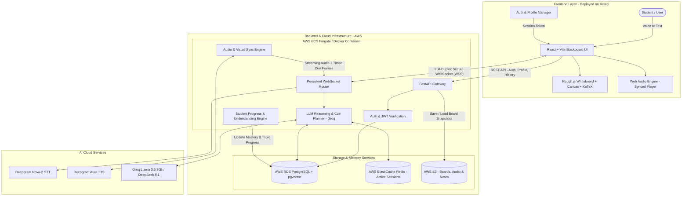

# Project Parashurama: Technical Architecture & System Decisions

> **Project Concept:** An intelligent AI Tutor that accepts user input through text or speech and simultaneously explains concepts on a dynamic whiteboard using synchronized voice (TTS) and live visual representations (drawings, formulas, flowcharts, and text).

---

## 1. High-Level System Architecture

The following Mermaid diagram has been corrected for GitHub Markdown compatibility.



---

## 2. Technical Decision Matrix & Questionnaire

### Phase 1: Whiteboard Engine & Visual Representations

#### Question 1.1: Which rendering technology should power the whiteboard?

- [ ] **Option A (Recommended - Hybrid Canvas & SVG with Rough.js)**
  - Natural hand-drawn appearance (similar to Excalidraw).
  - Supports geometric shapes, arrows, handwriting text, mathematical formulas (KaTeX), and automatic layouts.
  - Smooth animations targeting 60 FPS.

- [ ] **Option B (Excalidraw Core Embedded)**
  - Uses the complete open-source Excalidraw engine.
  - Pros: Built-in shapes, pan/zoom, eraser, and laser pointer.
  - Cons: Larger bundle size; programmatic remote control requires interacting with Excalidraw's internal state.

- [ ] **Option C (Fabric.js / Konva.js Canvas)**
  - Object-oriented 2D canvas supporting shapes, text, and timeline animations.
  - More corporate and diagrammatic appearance rather than a hand-drawn blackboard style.

- [ ] **Option D (Mermaid.js + Markdown + KaTeX Stream)**
  - Non-canvas approach that dynamically generates standard diagrams, flowcharts, and Markdown notes.

**Your Choice: Option A**

**Additional Notes:** Hybrid Canvas and SVG rendering using Rough.js.

#### Question 1.2: What visual primitives should the AI Tutor generate?

- [x] Animated handwriting and callout text.
- [x] Diagrams and flowcharts.
- [x] Mathematical and scientific formulas using LaTeX/KaTeX.
- [x] Coordinate grids and 2D graphs.
- [x] Bullet points and summary cards.
- [ ] Code snippets with syntax highlighting.
- [x] Complex anatomical and biological schematics (human organs, biology, and physics).

#### Question 1.3: How should complex scientific diagrams and human organs be drawn accurately?

**Your Choice: Option A - Hybrid Vector Asset Library + Progressive Chalk Draw-In + Dynamic LLM Callouts**

- Maintain a pre-indexed SVG line-art library containing high-quality anatomical and scientific diagrams.
- Include heart, brain, nephron, digestive system, DNA, physics optics, electrical circuits, and chemical structures.
- Animate SVG strokes using `stroke-dashoffset` or appropriate Rough.js rendering techniques.
- Allow the LLM to generate dynamic labels, arrows, highlights, and callouts.
- Synchronize component highlights with the tutor's speech.

**Additional Notes:** Maintain an anatomical asset library with progressive chalk-stroke animations and synchronized pointer callouts.

---

### Phase 2: Audio-Visual Synchronization

#### Question 2.1: How should synchronization between speech and board drawing be handled?

**Your Choice: Option A - Timestamped Cue Events via Web Audio API**

The LLM generates two coordinated outputs:

1. Speech script divided into sentences or phrases.
2. Visual actions associated with timestamped cue events.

Example:

```text
[cue:1] Draw coordinate axis.
[cue:2] Plot parabola.
[cue:3] Highlight the vertex.
```

- TTS generates audio with word-level or sentence-level timing information.
- The frontend uses `AudioContext.currentTime` to schedule visual actions.
- Board animations and audio playback remain synchronized.
- Pause, resume, rewind, and playback-speed changes must update both tracks together.

---

### Phase 3: Speech Input (STT) & Speech Output (TTS)

Existing API keys:

- `DEEPGRAM_API`
- `GROQ_API`

#### Question 3.1: Which STT provider should capture user questions?

**Your Choice: Option A - Deepgram Nova-2 / Live WebSocket**

- Near-real-time streaming transcription.
- Word-level timestamps.
- Suitable for continuous speech input.
- Supports low-latency voice interactions.

#### Question 3.2: Which TTS provider should voice the tutor?

**Your Choice: Option A - Deepgram Aura**

- Natural conversational voices.
- Low-latency speech generation.
- Suitable for real-time educational explanations.
- Supports streaming audio integration.

---

### Phase 4: LLM Orchestration, Models & Groq Test Matrix

#### Question 4.1: Which model should generate explanations and whiteboard storyboards?

**Your Choice: Option A - Multi-Model Support & Groq Benchmarking**

**Primary Realtime Driver:**
- Groq `llama-3.3-70b-versatile`.
- Used for fast explanations and streaming whiteboard cues.

**Reasoning Driver:**
- Groq `deepseek-r1-distill-llama-70b`.
- Used for complex mathematical reasoning and step-by-step scientific explanations.

**Additional Model Support:**
- Pluggable model switcher.
- Support for larger open-source models as they become available.
- Benchmark different models for performance and reliability.

**Additional Notes:**

Create an automated benchmarking script:

`backend/benchmarks/test_models.py`

Measure:

- Time to First Token (TTFT).
- Token generation throughput.
- JSON cue generation reliability.
- Response latency.
- Output consistency.

#### Question 4.2: How should the LLM represent anatomical structures?

**Your Choice: Option A - Semantic Asset Identifier + Coordinated Micro-Cue Animations**

Example schematic instruction:

```json
{
  "type": "schematic",
  "asset": "anatomy/heart",
  "draw_duration_ms": 3000
}
```

Example synchronized callout:

```json
{
  "type": "callout",
  "target": "left_ventricle",
  "label": "Left Ventricle",
  "speech_sync": "Blood is pumped to the aorta."
}
```

This approach ensures that anatomical structures come from verified assets rather than relying on potentially inaccurate, LLM-generated SVG paths.

---

### Phase 5: Communication Protocol & Frontend Stack

#### Question 5.1: How should the frontend communicate with the backend?

**Your Choice: Option A - Full-Duplex WebSockets**

- Bidirectional real-time communication.
- Streaming audio and visual events.
- Supports user interruptions.
- Allows continuous voice input and synchronized output.
- Enables real-time interaction between the frontend and backend.

#### Question 5.2: What should the UI theme and layout look like?

**Your Choice: Option A - Sleek Dark Slate / Chalkboard Mode**

- High-contrast charcoal or blackboard background.
- Vibrant chalk colors: cyan, neon amber, emerald, and white.
- Floating tutor voice visualizer.
- Interactive playback timeline.
- Clean educational interface.

---

### Phase 6: User Controls & Interactivity

#### Question 6.1: What controls should users have over lectures?

**Selected Features:**

- [x] Pause and resume playback, synchronizing audio and drawing.
- [x] Rewind and fast-forward timeline slider.
- [x] Clear board.
- [x] Download notes as PDF or PNG.
- [x] Interrupt and ask follow-up questions.
- [x] User freehand pen for drawing over the AI whiteboard.
- [x] Playback speed selector: 0.75x, 1x, 1.25x, and 1.5x.

---

### Phase 7: Multi-User Authentication & Profiles

#### Question 7.1: Which authentication provider should be used?

**Your Choice: Option A - Clerk / Supabase Auth**

- Google, GitHub, and email/password authentication.
- Secure JWT-based authentication.
- Stateless token verification through FastAPI.
- Session persistence.
- User profile management.

Backend integration:

`Depends(verify_token)`

#### Question 7.2: What student profile attributes should be tracked?

**Selected Attributes:**

- [x] Target educational level: Middle School, High School, Undergraduate, Professional.
- [x] Preferred learning pace: Concise explanations or detailed step-by-step explanations.
- [x] Tutor persona and accent: Encouraging mentor, academic professor, or Socratic questioner.
- [x] Primary subject focus: STEM, Medicine/Biology, Coding, or General Science.

---

### Phase 8: Memory Storage & Cross-Session Recall

#### Question 8.1: How should the multi-tier memory system be structured?

**Your Choice: Option A - Three-Tier Memory Architecture**

**1. Working Memory - Redis / ElastiCache**

Stores active session information:

- Current lecture state.
- Uncommitted whiteboard strokes.
- Live speech buffers.
- Temporary interaction context.

**2. Episodic & Relational Memory - PostgreSQL**

Stores:

- Structured lesson history.
- Lecture transcripts.
- Whiteboard snapshots.
- Timestamped cue logs.
- Student interaction records.

**3. Semantic Memory - pgvector**

Stores vector embeddings of:

- Student queries.
- Previous misconceptions.
- Lecture summaries.
- Important learning concepts.

**Recall Example:**

When a student struggles with derivatives, the tutor can retrieve previous learning context:

"Last week, when we covered derivatives, you had a similar question about the chain rule."

---

### Phase 9: User Understanding & Learning Progress

#### Question 9.1: How should student understanding and topic mastery be measured?

**Your Choice: Option A - Bayesian Knowledge Tracing & Concept Graph**

- Organize topics into a directed knowledge graph.
- Track mastery probabilities for individual concepts.
- Update mastery based on comprehension checkpoints and assessment results.

Example:

`Calculus → Algebra → Arithmetic`

Each concept receives a mastery score between 0% and 100%.

#### Question 9.2: How should the AI Tutor assess understanding in real time?

**Selected Features:**

- [x] Interactive in-lecture checkpoints.
- [x] Socratic diagnostic feedback.
- [x] Student learning analytics dashboard.
- [x] Post-lecture quiz and summary card.

**Functional Details:**

- Pause narration and ask questions.
- Accept verbal or text-based answers.
- Identify misconceptions.
- Adapt diagrams and explanations based on student responses.
- Display mastery heatmaps.
- Estimate knowledge retention and recommend spaced-repetition reminders.
- Generate three practice problems after each lecture.

---

### Phase 10: Cloud Deployment & DevOps Architecture

#### Question 10.1: How will the frontend be deployed?

**Your Choice: Option A - Vercel Edge & Static Hosting**

- Connect the GitHub repository: `Parushuram-frontend`.
- Automatic CI/CD deployment on `git push origin main`.
- Global CDN distribution.
- Configure environment variables through the Vercel dashboard.

Environment variables:

```env
VITE_API_URL=
VITE_WS_URL=
```

#### Question 10.2: How will the backend and database be deployed?

**Your Choice: Option A - AWS ECS Fargate + RDS PostgreSQL + S3 + ElastiCache**

**Compute:**
- Dockerized FastAPI application.
- AWS ECS Fargate.
- Application Load Balancer (ALB).
- Persistent WebSocket connections.

**Database:**
- AWS RDS PostgreSQL.
- pgvector extension.
- User information, lesson history, and semantic memory.

**Cache:**
- AWS ElastiCache Redis.
- Active session state.
- Temporary interaction data.
- Rate limiting.

**Asset Storage:**
- AWS S3.
- Whiteboard PNG/SVG exports.
- Lesson PDF notes.
- Cached audio files.

---

## 3. Data Flow Specification: Board Action DSL / JSON Schema

The LLM generates structured JSON instructions that tell the frontend what to draw and when to draw it.

### Example: Newton's Second Law of Motion

```json
{
  "speech_script": "Let's understand Newton's Second Law of Motion. Force equals mass times acceleration.",
  "cue_points": [
    {
      "cue_id": "c1",
      "timestamp_offset_ms": 0,
      "speech_snippet": "Newton's Second Law of Motion",
      "actions": [
        {
          "type": "text",
          "content": "Newton's Second Law: F = m · a",
          "position": {
            "x": 100,
            "y": 80
          },
          "style": {
            "color": "#f59e0b",
            "fontSize": 28,
            "handwritten": true
          }
        }
      ]
    },
    {
      "cue_id": "c2",
      "timestamp_offset_ms": 2400,
      "speech_snippet": "Force equals mass times acceleration",
      "actions": [
        {
          "type": "box",
          "bounds": {
            "x": 90,
            "y": 60,
            "width": 420,
            "height": 70
          },
          "stroke": "#38bdf8",
          "roughness": 1.5
        },
        {
          "type": "formula",
          "latex": "\\vec{F} = m \\frac{d\\vec{v}}{dt}",
          "position": {
            "x": 100,
            "y": 180
          }
        }
      ]
    },
    {
      "cue_id": "c3",
      "timestamp_offset_ms": 5200,
      "speech_snippet": "In the human heart, oxygen-depleted blood enters through the superior vena cava into the right atrium.",
      "actions": [
        {
          "type": "schematic_sketch",
          "asset": "anatomy/heart_cross_section",
          "position": {
            "x": 580,
            "y": 120
          },
          "scale": 0.85,
          "draw_style": "chalk_stroke_animation",
          "draw_duration_ms": 3200
        },
        {
          "type": "callout_pointer",
          "target_part": "right_atrium",
          "label": "Right Atrium (Deoxygenated)",
          "arrow_from": {
            "x": 500,
            "y": 180
          },
          "arrow_to": {
            "x": 620,
            "y": 200
          },
          "color": "#38bdf8",
          "highlight_pulse": true
        }
      ]
    }
  ]
}
```

**Important Implementation Requirement:**

The `timestamp_offset_ms` values must be coordinated with actual TTS audio timing. They should not be treated as reliable speech timestamps if the audio duration changes.

Prefer provider-generated word or sentence boundary timestamps, or align the speech segments with generated audio chunks. This ensures accurate synchronization.

---

## 4. Immediate Next Steps & Milestones

### Step 1: Finalize Technical Decisions
- Confirm the architecture and selected technologies.
- Finalize API contracts and JSON cue schema.
- Define frontend-backend communication events.

### Step 2: Initialize Frontend
- Set up Vite + React.
- Configure Rough.js and Canvas/SVG rendering.
- Integrate KaTeX.
- Build the dark chalkboard UI.
- Implement basic drawing primitives.

### Step 3: Configure Backend
- Set up FastAPI.
- Create WebSocket endpoints.
- Integrate Groq LLM.
- Integrate Deepgram STT and TTS.
- Configure environment variables securely.

### Step 4: Implement Audio-Visual Synchronization
- Build the Web Audio API playback engine.
- Implement timestamped cue scheduling.
- Synchronize audio and board animations.
- Support pause, resume, seek, and playback speed.

### Step 5: End-to-End Integration
Test the complete workflow:

```text
User Text / Speech Input
          ↓
Deepgram Speech-to-Text
          ↓
Groq LLM Reasoning
          ↓
Structured JSON Cue Generation
          ↓
Deepgram Text-to-Speech
          ↓
Audio-Visual Synchronization
          ↓
Live Whiteboard + Tutor Voice
          ↓
Interactive Student Experience
```

**Final Goal:** Build an intelligent, interactive AI Tutor that behaves like a real teacher, explaining concepts through synchronized speech, dynamic whiteboard drawings, accurate scientific diagrams, and personalized learning feedback.
